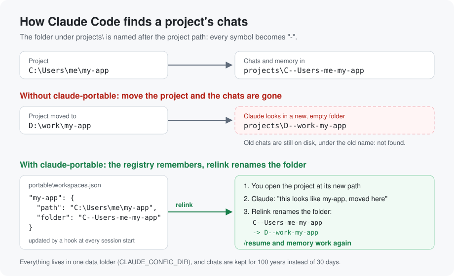
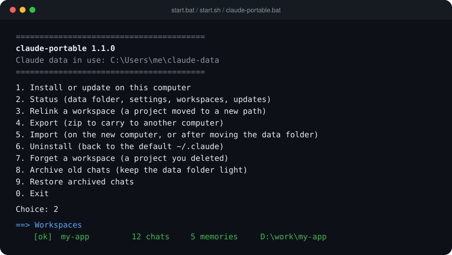
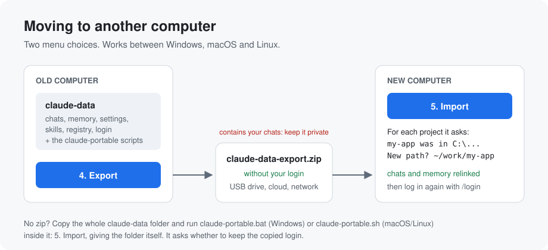

# claude-portable

[](https://github.com/CataniaDaavide/claude-portable/actions/workflows/tests.yml)

Keep everything [Claude Code](https://code.claude.com) knows about your projects (chats, auto memory,
settings, skills) in **one folder** that you can carry to another computer, and reconnect each
project to its chats even when it lives at a different path.

Windows, macOS and Linux. [Guida in italiano](README.it.md).



## The problem

Claude Code stores its data in `~/.claude` (`%USERPROFILE%\.claude` on Windows). Each project gets a
folder under `projects/` whose name is the project path with every non-alphanumeric character
replaced by `-`:

```
C:\Users\me\Desktop\my-app  ->  .claude\projects\C--Users-me-Desktop-my-app\
/home/me/code/my-app        ->  .claude/projects/-home-me-code-my-app/
```

That folder holds the project's chats (`*.jsonl`) and its auto memory (`memory/`). Move the project,
or open it on a computer with a different user name, and the path changes: Claude Code starts from
zero even if you copied the data. On top of that, chats older than 30 days are deleted by default.

## What claude-portable does

| Piece | What it does |
|---|---|
| **One data folder** | Sets the official `CLAUDE_CONFIG_DIR` variable, so Claude Code keeps all its data in a folder you choose (default `~/claude-data`). |
| **Chats are kept** | Sets `cleanupPeriodDays` to 36500 (about 100 years). Claude Code does not allow turning the cleanup off (`0` is rejected), so a very long period is the way to keep everything. |
| **Workspace registry** | `portable/workspaces.json` maps every project path to its folder under `projects/`. A `SessionStart` hook updates it each time you open a project. |
| **Relink** | When a project moves, one command renames (or merges) its folder to match the new path, so `/resume` and memory work again. |
| **Moved projects are noticed** | Open a moved project and Claude tells you at once that it looks like a registered workspace whose old path is gone, and offers to relink it. |
| **Claude knows how** | A short block in the user `CLAUDE.md` tells Claude about the registry, so you can just say *"my-app is now in D:\work\my-app"*. |
| **Export / Import** | A zip without your login to carry to another computer, and a guided import that asks where each project lives now. Works across systems. |
| **Self-check** | Status verifies that Claude Code still behaves the way claude-portable relies on, and tells you when a newer version is out. |

The scripts for every system, a launcher (`claude-portable.bat` / `claude-portable.sh`), a short
readme and these full guides (`portable/docs`) are copied into the data folder, so it works on its
own, even offline: on a new computer you do not need this repository
(see [Only the data folder](#only-the-data-folder)).

## Quick start

Close VS Code, every Claude Code terminal and the Claude desktop app, then:

**Windows** (PowerShell):
```powershell
irm https://raw.githubusercontent.com/CataniaDaavide/claude-portable/main/get.ps1 | iex
```

**macOS / Linux** (needs `python3`; on macOS run `xcode-select --install` if it is missing):
```sh
curl -fsSL https://raw.githubusercontent.com/CataniaDaavide/claude-portable/main/get.sh | sh
```

It downloads the latest version and opens the menu: choose **1. Install**. Then reopen VS Code /
your terminal (on a Linux desktop, log out and in again) and choose **2. Status** to check.

Prefer not to pipe a script from the internet? Download this repository (green **Code** button,
**Download ZIP**, or `git clone https://github.com/CataniaDaavide/claude-portable.git`) and run
**`start.bat`** (Windows) or **`sh start.sh`** (macOS/Linux). Same menu.

Install **copies** your data, it does not move it: the old `~/.claude` stays as a backup until you
delete it. On macOS the login lives in the Keychain and is tied to the data folder: log in again
once with `/login` after installing.

**Updating**: run the same one-line command; it offers to update the data folder in use.
**2. Status** tells you when a newer version is out. See the [changelog](CHANGELOG.md).

## Menu



| Option | Windows script | When |
|---|---|---|
| 1. Install or update | `scripts\install.ps1` | Once per computer, or to update the data folder |
| 2. Status | `scripts\status.ps1` | Any time: version, folder, retention, hook, workspaces, compatibility |
| 3. Relink | `scripts\relink-workspace.ps1` | A project moved to a new path |
| 4. Export | `scripts\export-data.ps1` | Before moving to another computer |
| 5. Import | `scripts\import-data.ps1` | On the new computer, or after moving the data folder |
| 6. Uninstall | `scripts\uninstall.ps1` | Go back to the default `~/.claude` |
| 7. Forget | `scripts\forget-workspace.ps1` | A project you deleted: its chats move to `portable/forgotten` |
| 8. Archive old chats | `scripts\archive-chats.ps1` | Chats untouched for months (default 180 days) are zipped into `portable/archive` and leave `/resume` |
| 9. Restore archived chats | `scripts\restore-chats.ps1` | Puts them back, with their original dates |

On macOS/Linux the same commands are `python3 unix/claude_portable.py <install|status|relink|export|import|uninstall|forget|archive|restore>`;
add `--help` to any of them. Windows example:

```powershell
powershell -ExecutionPolicy Bypass -File scripts\relink-workspace.ps1 -Name my-app -NewPath "D:\work\my-app" -DryRun
```

## Moving to another computer



**Old computer**: menu **4. Export**. You get `claude-data-export-<date>.zip` (on the Desktop on
Windows, in your home folder on macOS/Linux).

**New computer**:
1. Install Claude Code, then copy the zip.
2. Run the one-line installer (or this repository's `start.bat` / `start.sh`) and choose **5. Import**,
   giving the zip and the new data folder.
3. For each workspace whose path does not exist here, type the new path (or press Enter to do it later).
4. Restart VS Code / terminals and log in again (`/login`).

Windows, macOS and Linux can be mixed: a folder exported on Windows imports on a Mac, and the other
way round. Copying the whole data folder (USB drive, sync tool) instead of the zip also works: see
the next section.

## Only the data folder

If on the new computer you have just the data folder (no repository, no zip):

1. Install Claude Code and copy the data folder where you want it, e.g. `~/claude-data`.
2. Run the launcher inside it, **`claude-portable.bat`** (Windows) or **`sh claude-portable.sh`**
   (macOS/Linux), and choose **5. Import**.
3. As the folder to import give the copied folder itself, then press Enter to keep it where it is.
4. The folder contains the login of the old computer (`.credentials.json`): the import asks whether
   to keep it. Removing it and logging in again with `/login` is the safer choice.
5. Type the new path of each project (or press Enter to relink it later), then restart VS Code.

Without the launcher (data folders made by 1.0.0), open the menu with:

```powershell
powershell -ExecutionPolicy Bypass -File "C:\Users\<you>\claude-data\portable\scripts\claude-portable.ps1"
```

## Moving a project on the same computer

Close Claude Code in that project, move the folder, then simply open it from the new place:
Claude notices it looks like the moved workspace and offers to relink it. You can also:
- use menu **3. Relink**, or
- ask Claude from any project: *"my-app moved to D:\work\my-app, relink it"*.

If Claude suggests a relink for a project that is actually a different one with the same folder
name, say so: it registers it as a new workspace and stops asking.

## Moving the data folder on the same computer

Close VS Code, move the folder (for example to `D:\claude-data`), run the launcher inside it and
choose **5. Import** with the new path (Enter at the second question). It points Claude Code to the
new place; keep the login when asked, it is your own computer.

## What is not portable

- **Your login** (`.credentials.json`) is never put in the export zip: log in again on the new
  computer. A data folder copied as is does contain it, and the import asks whether to keep it.
- **Folder trust and per-project permissions** (kept by path in `.claude.json`) are copied to the
  new path by relink. If Claude Code was open during the relink it may still ask once: accept.
- **Checkpoints** (`file-history`) refer to old file paths and are not useful after a move.

## Privacy

Chats contain everything you typed and everything commands printed, which may include passwords,
tokens or customer data. Keep the data folder and the export zip private, never commit them to git,
and do not put them in a public cloud folder without encryption.

## How it works (details)

- `CLAUDE_CONFIG_DIR` tells Claude Code where to keep settings, chats, memory, plugins, skills,
  `.claude.json` and the login. On Windows it is a user environment variable; on macOS/Linux an
  `export` line in your shell files (`~/.zshrc`, `~/.bashrc`, `~/.profile`), plus
  `~/.config/environment.d` on Linux desktops and a LaunchAgent on macOS for apps started from the
  Dock. Uninstall removes all of them.
- The hook resolves its script from `CLAUDE_CONFIG_DIR` at run time, so it keeps working after the
  folder moves. Windows (works in Git Bash and PowerShell alike):
  ```
  powershell.exe -NoProfile -NonInteractive -ExecutionPolicy Bypass -Command '& (Join-Path $env:CLAUDE_CONFIG_DIR portable\scripts\register-workspace.ps1)'
  ```
  macOS/Linux:
  ```
  python3 "$CLAUDE_CONFIG_DIR/portable/unix/claude_portable.py" hook
  ```
  It prints nothing except the moved-project note (hook output is added to Claude's context) and
  never fails the session; errors go to `portable/hook-errors.log`.
- Relink also copies the project's entry in `.claude.json` (folder trust, allowed tools, project MCP
  servers) to the new path, keeping the old entry and saving a backup of the file first. On Windows
  both drive-letter spellings (`C:/` and `c:/`) are written, because Claude Code keys the entry by the
  path exactly as it received it.
- Archived chats sit in `portable/archive/<project folder>.zip`; they follow relink and forget,
  travel with Export, and restore with their original dates. Memory is never archived.
- Relink merges into an existing folder without overwriting anything: `MEMORY.md` indexes are merged
  line by line, files that exist on both sides keep the newer location's copy, and the old folder is
  moved to `portable/relink-backups/`.
- Project folder names longer than 200 characters get a hash suffix from Claude Code; relink finds
  those by prefix.
- claude-portable relies on two Claude Code behaviours that are not a documented contract: how
  project folders are named, and that `.claude.json` moves with `CLAUDE_CONFIG_DIR`. **2. Status**
  checks both on your own data, so a Claude Code update that changes them is noticed at once.

## Tests

Every push runs the test suites on Windows, Linux and macOS (see the badge above). To run them
locally:

```sh
powershell -ExecutionPolicy Bypass -File tests\run-tests.ps1   # Windows
python3 tests/test_unix.py -v                                  # macOS / Linux
```

They work on fake data in a temporary folder and never touch your real Claude data.

## Requirements

- Windows 10/11 with Windows PowerShell 5.1 (preinstalled), or macOS / Linux with Python 3.8+
- Claude Code (CLI, VS Code extension or desktop app)

## License

MIT, see [LICENSE](LICENSE).
